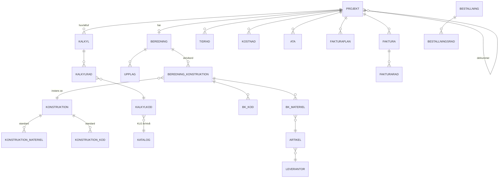

# ONE Bered – systemarkitektur och MVP-plan

**Syfte:** Molnbaserad, förenklad ersättare för Guru (Elpool) för elnätsentreprenad 0,4–24 kV: projekt → EBR-beredning → kalkyl (KLG) → inköp → tid/kostnad → fakturering → uppföljning.
**Underlag:** Guru användarmanual kap 1–14 (Elpool, 2015–2020), EBR KLG 1:26 Kostnadskatalog lokalnät (mars 2026).
**Status:** Klickbar prototyp finns (artifact "ONE Bered"). Detta dokument beskriver målarkitekturen.

---

## 1. Sammanfattning – viktigast först

| | |
|---|---|
| **Rekommendation** | Bygg en modulär webbapp (TypeScript, React/Next.js) på PostgreSQL med projektnumret som nav – samma princip som Guru – men med parametriska konstruktioner, beräkningsmotor i ett delat bibliotek och integrationer via API i stället för filöverföring. |
| **MVP (ca 4–5 mån, 2–3 utvecklare)** | Projekt, beredning (konstruktionsbibliotek → materiel + P2/P3-koder), kalkyl P2/P3 med faktorer/risk/vinst, inköp (beställning per leverantör), tid & kostnad, fakturaplan/löpande/ÄTA, uppföljning kalkyl vs utfall. |
| **Utanför MVP** | Plannummer/budget, markvärdering, störningsrapportering, flextid/löneavtal, personalliggare, SMS. |
| **Största risker** | 1) Licens för maskinläsning av EBR-kataloger. 2) Grossistintegration (E-nr, nettopriser, e-order). 3) Konstruktionsbiblioteket kräver beredarnas tid att bygga upp. 4) Migrering från befintligt Guru. |
| **Beslut som behövs** | Driftplattform (Azure vs Supabase), om tidrapportering ska ligga här eller i befintligt system, vilka grossister som ska kopplas först. |

---

## 2. Vad Guru gör – och vad som tas med

Källa: Guru-manualen. Bedömning per modul (A = MVP, B = senare, C = utelämnas).

| Guru-modul | Kärnfunktion i Guru | ONE Bered | Prio |
|---|---|---|---|
| Projekt (kap 4) | P-nr (8 siffror + 3 delnr), tillfälliga/fasta, projekthuvud, kopplingar, tidlägen, dagbok, konto, kostnadsregistrering | Samma begrepp. Delnummer = barnprojekt. | A |
| Kalkylering (kap 5) | P1/P2/P3/P5, grund-/fri-/risk-/vinstkalkyl, egna koder, faktorer/priser, eget materiel, matris, import Excel/mallar, konvertering via frekvens, avtalskalkyl | Allt utom avtalskalkyl och P5 i MVP. Konvertering P1→P2→P3 i fas 2. | A |
| Kalkyladministration | Kataloger byggda av delkataloger, egna koder, mallar, sekretess | Katalogimport per år + egna koder + mallar. | A |
| Beredning (kap 8) | Konstruktionsgrupp → konstruktion → upp till 6 undergrupper → materiel + P3/P2-koder; skrivbord; identitet; lin/kab; ordning; upplag/kombination; listor; åtgärder (byt artikel i hela beredningen); byggprotokoll | Parametriska konstruktioner (längd, kabeltyp, schakt). Skrivbord, identitet, upplag, kombination, byt artikel globalt. | A |
| Kalkyl i beredning (8.1) | Koder kopplade till konstruktion/schakt, synkad beredningskalkyl, export till kalkylmodul | Inbyggt: koderna lever på konstruktionen, "Kalkyl av beredning" skapar kalkyl. | A |
| Schaktprotokoll (8.5) | Sträckor, förläggningssätt, schaktprofil, utförd | Schaktsträckor kopplade till kabelkonstruktioner. | B |
| Depå & lager (kap 7) | Leverantörskataloger, depå, uttag/retur, inventering | Katalogimport + enkel depå (uttag till projekt). | B |
| Inköp | Beställning per leverantör, e-post/EDI, prisjämförelse, saldo hos grossist | Beställning per leverantör och upplag; e-post/PDF i MVP, e-order (PEPPOL/EDI) fas 2. | A |
| Tidredovisning/Flextid (kap 6) | Tid med klockslag, avtalstolkning, traktamente, attest, periodlåsning | Enkel tid per P-nr/roll + attest. Avtalstolkning stannar i lönesystemet. | A (förenklad) |
| Plannummer (kap 9) | Planer per utförandeår, budgetramar | – | B |
| Uppföljning (kap 11) | U20 kalkyl vs kostnad, U30/U50 tid, U60 direktörsrapport, U240 kalkylkoder | Projektuppföljning + portföljvy + export. | A |
| Fakturering | Fakturaplan, fast/löpande, delfakturor, bilagor | Fakturaplan, löpande underlag, ÄTA (ABT 06), export till ekonomisystem. | A |
| Markvärdering (kap 12) | Ersättning markägare | – | C (eller B vid behov) |
| Personalliggare (kap 14) | ID06/personalliggare | Använd befintlig tjänst. | C |

**Förenklingar mot Guru (medvetna val):**
- Ett gränssnitt per objekt i stället för Gurus "urval → arbeta vidare med"-listor. Favoriter ersätts av "Mina projekt" + sök.
- Ingen låsning av beredningar vid felaktig utloggning – optimistisk låsning per post (versionsnummer).
- Konstruktioner byggs med parametrar och formler (`langd*1.03`, `langd/1000`) i stället för hundratals fasta varianter.
- Allt sparas automatiskt med ändringslogg (Guru: "går inte att ångra" i kalkyl).

---

## 3. Domänmodell



Fullständigt schema: `schema.sql` (PostgreSQL, 30+ tabeller, RLS per organisation).

**Nyckelregler**
1. Allt kopplas till P-nr. Utan P-nr ingen beställning och ingen faktura (som i Guru).
2. En beredning per (del)projekt. Flera kalkyler per projekt; exakt en `uf` (uppföljningskalkyl).
3. Kalkylkod refererar till en *katalogversion* (KLG 1:26). Kalkyler låser sin katalog; byte av år görs med "Flytta till annan katalog" och felrapport för koder som saknas.
4. Beredningskonstruktion = instans av standardkonstruktion + parametrar. Generering ger materiel och koder; manuella ändringar flaggas `manuell` och skrivs inte över vid omgenerering.

---

## 4. Beräkningsmotor (implementerad i prototypen)

Per kalkylrad med antal *n*, tidsfaktor *f*, timpriser *r* och påslag *p*:

| Kostnadsslag | Formel | Not |
|---|---|---|
| Timmar | `bered_h·n·f`, `mont_h·n·f`, `maskin_h·n·f` | |
| Arbete | `(bered_h·r_bered + mont_h·r_mont)·n·f·(1+p_arb)` | Faller tillbaka på `arbete_kr·n` om timmar saknas |
| Maskin | `maskin_kr·(r_maskin/1190)·n·f·(1+p_mskn)`; P3: `maskin_h·r_maskin` | 1190 kr/h = KLG:s kabelschaktmaskin – **antagande** för skalning |
| Materiel | `material_kr·n·(1+p_mtrl)` eller beredningens materiellista | Val per kalkyl |
| Övrigt | `ovrigt_kr·n·(1+p_ovr)` | |
| Risk-/vinstkalkyl | `grund·(1+risk)`, `risk·(1+vinst)` | Som Gurus visningslägen |

**Fakta ur KLG 1:26:** timkostnad montör 982 kr/h, beredare 1 077 kr/h (inkl. omkostnadspålägg); kabelschaktmaskin 1 190, grävmaskin 1 170, ledningsbyggnadsmaskin 1 225 kr/h. P3 anger endast timmar.
**Kontroll:** Prototypens omräkning ger samma arbetskostnad som katalogen (t.ex. 510.01: 3,6 h × 1 077 = 3 877 kr mot katalogens 3 875 kr – avrundning).

Motorn ska ligga i ett delat TypeScript-paket (`@onebered/calc`) som körs både i klient (direkt respons) och server (sanning vid låsning, export, faktura). Enhetstester mot ett urval katalograder.

---

## 5. Teknisk arkitektur

```mermaid
flowchart LR
  subgraph Klient
    W[Webbapp React/Next.js<br/>PWA för fält]
  end
  subgraph Plattform
    API[API-lager<br/>Next.js route handlers / tRPC]
    CALC[@onebered/calc<br/>beräkningsmotor]
    JOB[Bakgrundsjobb<br/>katalogimport, e-order, export]
    DB[(PostgreSQL<br/>RLS per org)]
    BLOB[(Fillagring<br/>bilder, dokument)]
  end
  subgraph Integrationer
    IDP[Entra ID SSO]
    GROSS[Grossister<br/>katalog + e-order]
    EKO[Ekonomisystem<br/>fakturor, verifikat]
    LON[Lön/tid]
    SP[SharePoint/Teams]
  end
  W --> API --> DB
  API --> CALC
  JOB --> DB
  API --> BLOB
  W -.-> IDP
  JOB <--> GROSS
  JOB <--> EKO
  JOB --> LON
  API --> SP
```

| Lager | Val | Motivering |
|---|---|---|
| Frontend | React + TypeScript (Next.js), tabellkomponent med tangentbordsnavigering (AG Grid/TanStack Table) | Beredare arbetar i stora tabeller – Excel-lik inmatning är ett krav. |
| Backend | Next.js API / tRPC, Zod-validering | En kodbas, typsäkert end-to-end. |
| Databas | PostgreSQL 15+, Row Level Security per `org_id` | Relationell data, transaktioner för beställning/faktura. |
| Auth | Entra ID (OIDC) | **Antagande:** ONE Nordic kör M365 – SSO utan nya lösenord. |
| Drift | **Alt A:** Azure (App Service + Azure Database for PostgreSQL + Blob). **Alt B:** Supabase + Vercel. | A passar M365-miljö och IT-krav; B är snabbast för MVP. |
| Offline | PWA med lokal cache för tid och dagbok | Fält saknar ofta täckning. Beredning/kalkyl kräver inte offline i MVP. |
| Export | Excel (xlsx), PDF (byggprotokoll, materiellista, faktura), SIE4 | Guru-användare förväntar sig "till Excel" överallt. |

**Icke-funktionella krav**
- Svarstid < 300 ms för kalkylomräkning med 1 000 rader (klientberäkning).
- Ändringslogg på kalkyl, beredning, ÄTA, faktura (vem/när/vad).
- Roller: admin, projektledare, beredare, projektör, montör, ekonomi, läsare.
- Backup dagligen, PITR 7 dagar. Data i EU.

---

## 6. Integrationer

| Integration | MVP | Fas 2 | Not |
|---|---|---|---|
| EBR KLG-kataloger | CSV-import (parser för PDF finns, se nedan) | Direktleverans från EBR om sådan finns | **Licens:** maskinläsning och lagring av KLG kräver avtal med Energiföretagen/EBR. Kontrollera innan produktion. |
| Grossistkataloger (E-nr, nettopriser) | Excel/CSV-import per leverantör | Automatisk prisfil, saldo, prisjämförelse | Guru har detta mot Elektroskandia, Onninen, Rexel/Selga. Underlag saknas om era avtal – **uppgift saknas**. |
| E-order | PDF/e-post till leverantör | PEPPOL/EDI | |
| Ekonomisystem | Export fakturaunderlag (CSV/SIE) | API: leverantörsfakturor in per P-nr, kundfakturor ut | Vilket ekonomisystem? – **uppgift saknas**. |
| Tid/lön | Egen enkel tid | Import från befintligt tidsystem | Avgör om tid ska ligga här. |
| SharePoint | Länk till projektmapp | Dokument synk | Koppling till befintlig Projekthub/Montörspärm möjlig. |

---

## 7. Beredningsflöde (målbild)

1. Projekt skapas (P-nr, kund, debitering, kontraktssumma).
2. Beredning öppnas från projektet. Beredaren väljer konstruktion ur biblioteket och fyller i parametrar (t.ex. *Kabelsträcka 0,4 kV, N1XV 4x95, 120 m, eget schakt N035–N055, tätort*).
3. Systemet genererar materiel (kabel +3 % spill, markeringsnät, anslutningar) och P2-koder (155.16, 140.02, 137.03, 140.80, 140.82, 140.69 ×2).
4. Identitet sätts (KS 12, NS 4471), upplag kopplas.
5. **Kalkyl av beredning** summerar koderna till en P2-kalkyl; projektledaren lägger faktor, risk och vinst → offertunderlag.
6. **Skapa beställning** grupperar materiellistan per leverantör och upplag.
7. Tid och kostnader rapporteras mot P-nr; ÄTA registreras och godkänns.
8. Fakturering enligt fakturaplan (fast pris) eller underlag (löpande); godkända ÄTA följer med.
9. Uppföljning visar kalkyl mot utfall per kostnadsslag och prognos.

**Antaganden i prototypens konstruktionsbibliotek (verifiera mot EBR/egen standard):**
- Kabelviktsklass för utdragning (140.01–04): N1XV 4x50 → ≤1 kg/m, 4x95–150 → >1–2,5 kg/m, 4x240 → >2,5–4,5 kg/m. KLG:s tabell är tvetydig i PDF-texten.
- Spill kabel 3 %. Två anslutningar per lågspänningssträcka.
- Materielpriser är härledda ur KLG:s materielkostnad per enhet – inte grossistpriser.

---

## 8. MVP-plan

| Fas | Innehåll | Tid (uppskattning) |
|---|---|---|
| 0. Förstudie | Workshop med 2 beredare + 1 PL: konstruktionsstandard, Guru-export, licensfrågor, ekonomisystem | 2–3 v |
| 1. Grund | Auth, org/roller, projekt, katalogimport KLG, artikelimport, beräkningsmotor + tester | 4 v |
| 2. Beredning & kalkyl | Konstruktionsbibliotek (admin), skrivbord, identitet, upplag, kalkyl P2/P3, egna koder, Excel-export | 6 v |
| 3. Inköp, tid, faktura | Beställning (PDF/e-post), tid & kostnad, ÄTA, fakturaplan, löpande underlag, SIE/CSV-export | 4 v |
| 4. Uppföljning & pilot | Uppföljning, portfölj, migrering av pågående projekt, pilot på 2–3 projekt | 3–4 v |

**Uppskattning:** ca 19–21 veckor kalendertid med 2–3 utvecklare. *Antagande* – beror på integrationsomfång och tillgång till beredare.

---

## 9. Risker

| Risk | Sannolikhet | Konsekvens | Åtgärd |
|---|---|---|---|
| EBR-licens tillåter inte maskinläsning/lagring av KLG | Medel | Hög | Kontakta EBR/Energiföretagen tidigt; stöd manuell inmatning av egna koder som reserv. |
| Konstruktionsbibliotek tar för lång tid att bygga | Hög | Medel | Börja med 10–15 vanligaste konstruktioner (JK 0,4/24 kV, skåp, station). Importera från Guru om export finns. |
| Grossistintegration dröjer | Medel | Medel | MVP med prisfil-import; e-order fas 2. |
| Användare saknar Guru-funktioner (tangentbord, listor) | Medel | Medel | Beredare i referensgrupp från fas 0; Excel-lik tabell. |
| Dubbelregistrering under övergång | Hög | Låg | Kör nya projekt i ONE Bered, avsluta gamla i Guru. |

---

## 10. Öppna frågor (underlag saknas)

1. Vilket ekonomisystem och lönesystem används?
2. Finns export från nuvarande Guru-installation (konstruktionsupplägg, artiklar, pågående projekt)?
3. Vilka grossister och avtal (nettoprislistor)?
4. Ska tidrapportering ligga i ONE Bered eller importeras?
5. Kundernas krav på format för fakturaunderlag och avtalskalkyl (t.ex. Ingrid Capacity, nätbolag)?
6. Behövs P1/plannummer för budgetering hos någon kund?

---

## Bilagor

| Fil | Innehåll |
|---|---|
| `schema.sql` | PostgreSQL-schema, parse-kontrollerat |
| `KLG1-26_katalog.csv` | KLG 1:26 maskinläst ur PDF: P1 415, P2 859, P3 1 080 koder. P1/P2-rader kontrollerade mot summakolumnen (arbete+materiel+maskin+övrigt = summa). P3-benämningar som löper över flera rader kan vara ofullständiga – stickprova före produktion. Endast för internt bruk inom licens. |
| `parse_klg.py` | Parser PDF-text → CSV/JSON (kör med `pdftotext -layout`) |
| Artifact "ONE Bered" | Klickbar prototyp med exempeldata. Data sparas endast i webbläsaren. |
